# Visual style

SMCP uses one application-wide theme from
[`resources/theme/smcp.qss`](../resources/theme/smcp.qss). `Application::ApplyTheme()`
applies it in three steps:

1. select Qt's Fusion style for consistent controls across supported Windows versions;
2. set Segoe UI 9 pt as the inherited application font; and
3. load the embedded `:/theme/smcp.qss` stylesheet from `resources/resources.qrc`.

Widget-specific styles should be exceptional. Keeping shared appearance in the QSS file
makes new dialogs match the rest of the program without duplicating declarations in Qt
Designer.

## Design tokens

QSS has no variables, so the token values are documented here and repeated literally in
the stylesheet. Search the complete QSS file before changing one.

| Token | Value | Purpose |
|---|---|---|
| `base` | `#f3f3f3` | Background of the main window, the Point Cloud Editor, dialogs, groups, menu bars and the status bar |
| `surface` | `#ffffff` | Views and editors |
| `border` | `#d1d1d1` | Group borders and separators |
| `progress-track` | `#d6d6d6` | Track of the progress bar |
| `hover` | `rgba(199, 199, 199, 0.4)` | Hovered view selector |
| `active` | `#c7c7c7` | Checked or pressed view selector |
| `accent` | `#3e8948` | Projector-alignment accent and calibrated-set dot |
| `selection` | `#dbe7f3` | Selected row of a tree, list or table (with dark text) |
| `muted` | `#666666` | Layer details and hidden layer names |
| `secondary-text` | `#5c5c5c` | Table headers and status-bar text |
| `divider` | `#ececec` | Hairline under each table and layer row |
| `visibility` | `#00529d` | Point-cloud visibility button |
| `hidden` | `#9a9a9a` | Visibility button of a hidden layer |
| `delete` | `#e43b44` | Danger buttons (Cancel of a running job), point-cloud delete button, error text |
| `delete-hover` | `#ee5059` | Hovered danger button |
| `delete-pressed` | `#c92f38` | Pressed danger button |
| `control-border` | `#bdbdbd` | Border of buttons, fields, comboboxes, lists and popups |
| `indicator-border` | `#757575` | Border of unchecked checkboxes and radio buttons |
| `field-hover-border` | `#8a8a8a` | Border of a hovered text or numeric field |
| `pressed` | `#e0e0e0` | Pressed button background; menu borders and separators |
| `button-hover` | `#e5f1fb` | Hovered button, combobox and spin-arrow background |
| `button-hover-border` | `#7ab8e8` | Hovered button border |
| `accent-blue` | `#0067c0` | Keyboard focus border, checked indicators, primary button, progress fill |
| `accent-blue-hover` | `#1975c5` | Hovered primary button or checked indicator |
| `accent-blue-pressed` | `#005a9e` | Pressed primary button |
| `accent-blue-tint` | `#cce4f7` | Checked toggle button, combobox list selection |
| `disabled-surface` | `#f5f5f5` | Disabled button or field background |
| `disabled-text` | `#a0a0a0` | Text of a disabled control |

Typography and geometry conventions:

| Element | Convention |
|---|---|
| Application text | Segoe UI 9 pt |
| Group and panel titles | 9 pt, regular weight |
| About-dialog labels | 9 pt; field names, version and copyright in `secondary-text` |
| About subtitle (full product name) | 11 pt, regular |
| About title (product name) | 21 pt, semibold |
| AI inference window title | 21 pt, semibold |
| Standard corner radius | 4 px |
| Dialog root layout | 9 px margins, 6 px spacing |
| About dialog layout | 24 px side margins, 14 px between blocks, fixed size; logo 72 px |
| Main-window group content | 6 px margins, 6 px spacing |

Fluent Windows sizes are expressed in effective pixels. At 96 DPI, the requested body and
caption sizes are 12 epx (9 pt), subtitle 20 epx is 15 pt, and title 28 epx is 21 pt.
Point-sized fonts retain Qt's DPI scaling. QWidget defaults enforce Segoe UI
for dynamically created dialogs as well as Designer forms.

Body text uses a single weight: no label, group title, panel header or table row is bold.
Hierarchy comes from position, spacing and color. The only heavier texts are the Fluent
titles listed above (About and the AI inference window).

The application icon is `resources/icons/app-icon.svg`. `SMCP_make_app_icon <svg> <folder>`
renders it to `app-icon.png` (window icon, set in `Application::ApplyTheme()`) and
`app-icon.ico` (executable icon, through `resources/app-icon.rc`); run it again after changing
the SVG. The Point Cloud Editor window uses `pointcloud-editor-icon.svg`, the icon of the
button that opens it.

## Stylesheet organization

Rules in `smcp.qss` move from broad to specific:

1. base surfaces (`QMainWindow`, `QDialog`, `QGroupBox`), menus and the status bar;
2. group-box geometry and titles;
3. item views, tables and text fields;
4. action buttons and the Current View selector's specific appearance;
5. point-cloud editor controls and layer panel;
6. progress bar, danger buttons and the AI inference window title; and
7. About-dialog typography.

Prefer selectors by widget type. Use an `objectName` selector only when one concrete widget
must differ from other widgets of the same type. For example, the right-side parameter
groups use a top separator while camera and projector groups use a complete border.

Action buttons (`QPushButton` and `QToolButton`), comboboxes, numeric spin boxes, and text fields have a white background, a 1 px
`control-border`, and 4 px corners. The interaction states follow four rules:

- **Hover** fills buttons and comboboxes with `button-hover`. Text and numeric fields keep their
  white background and only darken the border, so hovering never tints text being read or edited.
- **Keyboard focus** is always visible: every control takes the `accent-blue` border (2 px on
  checkbox and radio indicators). Flat buttons, which have no border, take a translucent accent
  background, and the layer-row buttons a dark border.
- **Checked** is an active state and uses the accent: toggle buttons take `accent-blue-tint` with
  an accent border, checkboxes and radio buttons an `accent-blue` fill with a white mark
  (`check-white.svg`, `radio-dot-white.svg`). Pressed stays gray (`pressed`).
- **Disabled** controls use `disabled-surface` and `disabled-text`; a disabled checked indicator
  is mid-gray, so it cannot be confused with an enabled checked one.

A dialog's main action is its **primary button**: `QPushButton[primary="true"]` has an
`accent-blue` background and white text. `EditorDialogStyle` sets the property on the accept
button of every dialog opened from the editor (the Accept/Yes role of a button box, or a
`done_button`/`export_button`), so new dialogs get it without extra code.

A button that stops a running job is a **danger button**: `QPushButton[danger="true"]` has the
`delete` background and white text. The Cancel of `ProcessingDialog`, `BusyProgressDialog` and
`AiInferenceProgressDialog` use it, as does the editor's Cancel command button. Cancel in a
parameter dialog only dismisses the dialog and stays a normal button.

## Dialog layout

The sphere measurement dialog is the model for every parameter dialog:

- an optional **Description** group (`description_group`) with one wrapped sentence or two that
  say what the command does;
- one group per topic (**Parameters**, **Files**, **Source**...), each a `QGroupBox` whose title
  is centered by the theme, containing a form layout; and
- the action buttons centered at the bottom, primary first.

Remove Outliers, Plane, Sphere and Export follow it. Register (ICP) has only the Parameters
group: its description was removed on purpose and `IcpDialogChecks` verifies that.

## Progress

`QProgressBar` follows the Fluent progress bar: a 4 px `progress-track` with an `accent-blue`
fill and no text inside it, because text over the fill is unreadable. A dialog that needs the
percentage shows it in a label next to the bar.

`ProcessingDialog` (corner detection, calibration, batch jobs) has a **Progress** group with
the current step, the bar and the percentage, a **Details** group with the log, and one centered
button: a danger **Cancel** while the job runs, a primary **Close** when it ends.
`BusyProgressDialog` (in `app/TaskRunner.h`) is the small version for jobs without a log: a
status line, an indeterminate bar and a centered danger Cancel. Cancel, Esc and the window's
close button only request the cancellation; the dialog stays until the job has stopped.

More specific rules preserve the flat Current View selector, the
transparent Add/Export header actions, and the layer-row visibility/color/removal controls.

Comboboxes and action buttons share 18 px minimum content height and 4 px vertical padding.
Dropdown lists use the same border and 4 px corners. `ComboBoxPopupStyle` installs a styled
item delegate so row padding follows QSS, suppresses native window shadows, and clips the
popup window to rounded corners. Its mask is reapplied after Qt's popup initialization.
Small layer-row controls retain their original sizes; Tools buttons remain 36 px.

Spin-box arrows use the same hover and pressed backgrounds as buttons. Checkboxes have
an 18 px indicator with the `indicator-border` and 4 px corners. Radio buttons share those
colors and row height (28 px), retaining a circular indicator and center dot. Text editors use the same
border, corners, and padding; internal spin-box and editable-combobox text fields remain borderless.

`EditorDialogStyle` matches accept/cancel widths within each dialog opened by the editor,
using the larger size hint after captions are set. It handles standard button-box roles,
confirmations, and custom Done/Continue/Cancel pairs, then refreshes layout to preserve spacing.
Editor file pickers use Qt dialogs so the same theme and sizing apply. The Add dialog uses
**Load** in place of **OK**. Measurement configuration groups Description and Parameters
like its Source and Compensation sections, with centered Done/Cancel buttons.

## Point-cloud layer panel

`PointcloudLayersPanel` occupies the left side of the black OpenGL viewport in a splitter.
Its **Point Clouds** header contains transparent, borderless buttons: delete (`trash.svg`,
shown when rows are highlighted), merge (`layers-arrow-down.svg`, shown with two or more
targets), add (`plus.svg`) and export (`file-down.svg`). Under the tree, in one row like the
Workspace buttons of the main window, are the ordinary buttons **All** (`square-check.svg`) and
**None** (`square-minus.svg`) and the **Apply to all** check box.

The layers are a flat `QTreeView#layer_tree` styled like the Workspace tree of the main window
(`QTreeView#image_tree`): 4 px of air above and below each row, the `selection` tint for
highlighted rows and the common view check box. Each row contains:

- the check box: checked shows the cloud, unchecked hides it. The name of a hidden cloud uses
  the `muted` color;
- a 14 px color square with 4 px corners and a `field-hover-border` outline, painted by the
  panel because its color belongs to the cloud. Clicking it opens the color chooser, whose
  preset entries show `QPainter`-drawn color previews; and
- the name, elided in the middle so the operation prefix and original name remain recognizable;
  the tooltip shows the full name and its origin.

There are no per-row buttons. Below the tree, the details of the first target cloud show its
full name, point count and color. Double-clicking the name renames the cloud, dragging rows
reorders them, and Del deletes after a confirmation. The first row has drawing priority.

The window icon of the editor is built by `EditorWindowIcon()`: the points of
`pointcloud-editor-icon.svg`, enlarged, on a white rounded square with a `control-border`
outline, so it stays readable at 16 px on any title bar. The button that opens the editor keeps
the original artwork.

The rotate and move gizmos and the bottom-right view selector use axis colors painted by
the viewer's `QPainter` overlay: X `#ff3352`, Y `#8bdc00`, Z `#2890ff`. The back half of each
ring is drawn at low opacity; the hovered or dragged handle is lighter and thicker; the
move center is a white circle; and the angle or offset label sits on a translucent dark
box. Selected points are orange (`#ff8c00`); the selection box has a dashed white outline
and a faint white fill.

The narrow **Tools** panel sits between Point Clouds and the viewport. It stacks 36 px
icon buttons for Select, Radial selection (`circle-dashed.svg`), Move, and Rotate. A horizontal separator
precedes temporary actions such as Delete selected points; that action's tooltip includes
the selected point count. Tooltips and accessible names identify every icon button.
Undo, Redo, and the history selector sit immediately below the viewport, aligned to its left edge.
Processing commands live in PointCloud, Fit and Measure menus. **Measure > Spheres** opens the
measurement configuration and has no icon. Actions can be activated again after cancelling.

The radial tool shows a white dashed circle and a thin orange stroke path. The circle radius
is in logical widget pixels and scales with Qt DPI handling. Selection colors update when the
stroke is released and its worker completes.

AI configuration groups Description and Parameters and centers its equal-width OK/Cancel
buttons. Only `#ai_model_configuration_editor` uses Cascadia Mono. Its white background stays
fixed on hover; a focused editor retains the normal focus border.
The supplied selection and outlier SVGs use a fixed `#333333` in place of `currentColor`
because Qt 5 does not resolve the original value.

The panel rows and buttons are defined in QSS. The color swatch is a deliberate
runtime `setStyleSheet()` exception because its value belongs to each cloud, not to the
application theme. `ProcessingDialog` colors error lines and an error status with the `delete`
token and warnings with a dark amber (`#9a6700`), and `Application::UpdateSetStatus()` paints the
set-state dots of the Workspace tree with `accent` (calibrated), `visibility` (processed) and
`delete` (chessboard not found). Two other color exceptions exist: `ProjectorWidget` paints the alignment
cross with `QPainter` because the mark is part of the projected image, and
`AiModelConfigDialog` colors its validation message with the `delete` token (`#e43b44`) only
while the JSON configuration is invalid.

## Main window

The main window follows the same rules as the editor: the `base` background, group titles in
the regular weight, and the Fluent menu bar described below. Its menus are **File**,
**Calibration** and **Help**, with captions in English and title case (**Change Directory...**,
**Save Vertical Image...**). The first title starts at the left edge of the Workspace list
(`QMainWindow > QMenuBar` adds the 4 px by which this window's content is further in).

In the Workspace tree the selected set uses the `selection` tint with dark text, and the check
box of each set is the dialog check box at row scale (14 px, `accent-blue` when checked). The
status bar has no item borders and uses the `secondary-text` color.

## Menu bars

Both windows share one menu style (`QMenuBar`, `QMenu`), after WinUI 3. In the editor, **File** contains project
Open/Save, with their existing icons and Ctrl+O/Ctrl+S shortcuts. **PointCloud**, **Fit** and **Measure**
contain the processing actions; **PointCloud > AI Models** is filled from WSL discovery. Every caption is in English.
The first title starts at the same x position as the **Point Clouds** header below it.
The bar uses the `base`
surface and 4 px rounded hover states; its flyout uses a `#f9f9f9` background, an `#e0e0e0` border,
8 px corners and 4 px rounded menu items. All menu typography inherits Segoe UI at 9 pt (12 epx).
The rules and the native clipping apply to every `QMenu` of the application, including
cascading submenus and context menus; no property has to be set on a new menu.
The popup uses an opaque surface and an 8 px native window mask, reapplied on show and resize.
The shared popup helper disables the native shadow. Avoid translucent menu windows in Qt 5 on
Windows: their rounded QSS background can expose stale pixels and dark corners in desktop composition.

## Tables

`QTableView` follows the Fluent data table: a white surface, a header in `secondary-text` with a
single line under it, rows of 32 px divided by `divider` hairlines, no vertical grid lines and no
zebra striping, 8 px of horizontal cell padding, and the `selection` tint for the selected row.
Text is aligned to the left and numbers to the right, and each header is aligned like its column.
A table that is only read has no focus rectangle (`setFocusPolicy(Qt::NoFocus)`) and no grid
(`setShowGrid(false)`); the hairlines come from the theme.

The sphere results (`SphereResultsDialog`) add two things. The header has two levels
(`ComparisonHeader`): **Original** and **Scale corrected** each sit over their pair
of columns, and the line under each title, slightly shorter than the pair, brackets it in place
of vertical lines. The title row of each cloud is tinted with `base` and cannot be selected;
`RowTintDelegate` paints that tint because a cell styled by the theme ignores its item's
background.

## AI inference window

`AiInferenceProgressDialog` uses standard widgets so the theme applies automatically: an
indeterminate `QProgressBar` (range 0 to 0) animates in the **Progress** group, followed by the latest
model output and elapsed time. Its Cancel is a danger button. The centered 72 px CPU/AI icon precedes the semibold 21 pt
**Thinking** title (Fluent Title, 28 effective pixels). The description names the current cloud
and its point count. The title rule lives in the progress section of `smcp.qss`.
The batch-delete header button uses the same transparent surface as Merge; only its SVG stroke
is red (`#d93f4b`). The dialog has no context-help button, and Escape is ignored so a long run is
not cancelled by accident.

## Adding UI without breaking consistency

- Create form-based dialogs as `.ui` files and keep the form next to its C++ class.
- Do not set `font` or `styleSheet` properties in Designer for ordinary controls; local
  properties override the global theme.
- Use standard Qt widgets whenever possible so existing rules apply automatically.
- Use 9 px margins and 6 px spacing on a dialog's root layout. Use 6 px for nested control
  groups.
- Put reusable previews in `src/ui/preview`, item models in `src/ui/models`, and widgets
  without their own form in `src/ui/widgets`.
- If a new control needs a semantic color, reuse a token or add and document one here and in
  the QSS header.
- Add SVGs and other embedded assets to `resources/resources.qrc`. Prefer `currentColor` or
  a white fill/stroke for icons displayed on dark or saturated button backgrounds.
- Verify normal, hover, pressed, checked, disabled, and keyboard-focus states.
  `SMCP_style_gallery <folder>` renders a table of control states, the focus state of each kind of
  control, the editor dialogs, the sphere results table and the progress dialogs to PNG files
  without opening the application.

## Current visual reference

These screenshots are screen captures of a Release build of version 3.6.8, taken by
`SMCP_doc_screenshots <workspace> <output directory>` (`tests/DocScreenshots.cpp`), which drives
the real application through a fixed script. They are visual references, not pixel-perfect
automated snapshots. Run the tool again after changing a window, with `SMCP_SETTINGS_DIR` set so
your own settings are not modified. The Capture reference is older: that window needs a
connected camera, so the tool does not open it.

| Window | Reference |
|---|---|
| Main window | 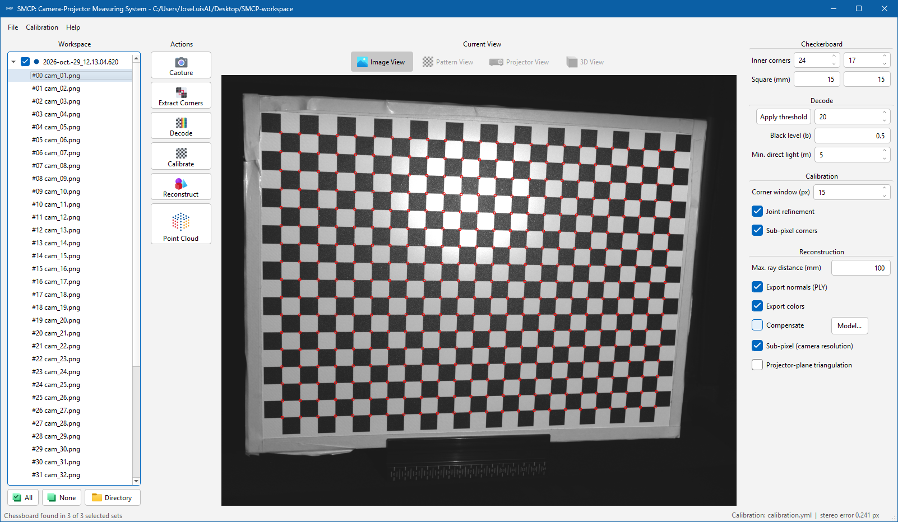 |
| Capture | 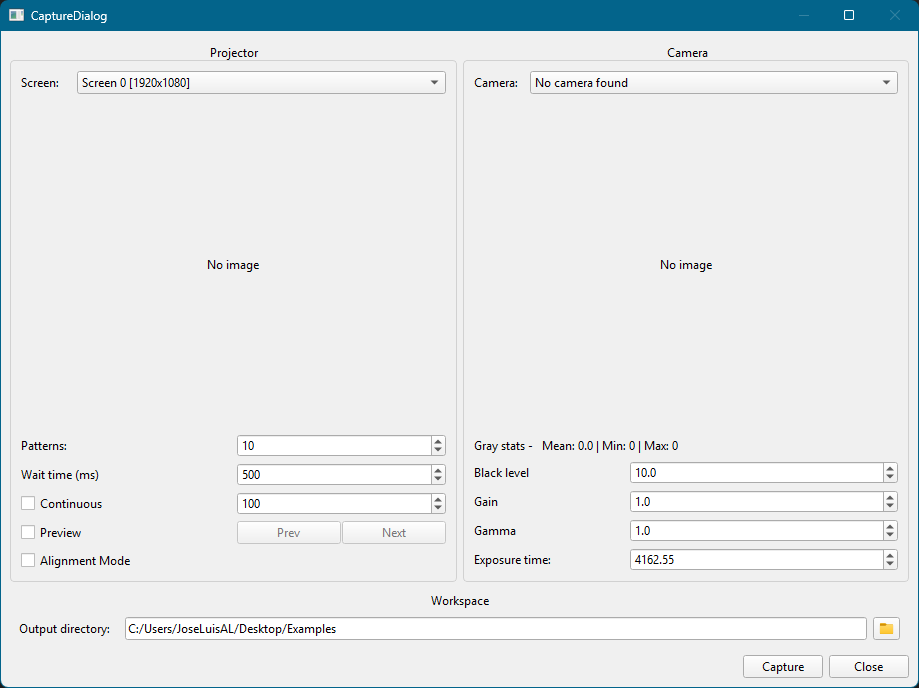 |
| Calibration | 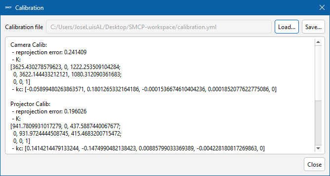 |
| About | 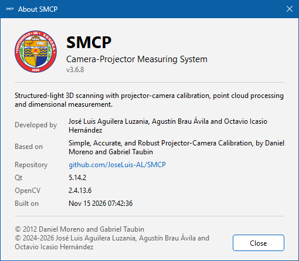 |

The point-cloud editor screenshots demonstrate its operations:

| State | Reference |
|---|---|
| Workspace cloud chooser | 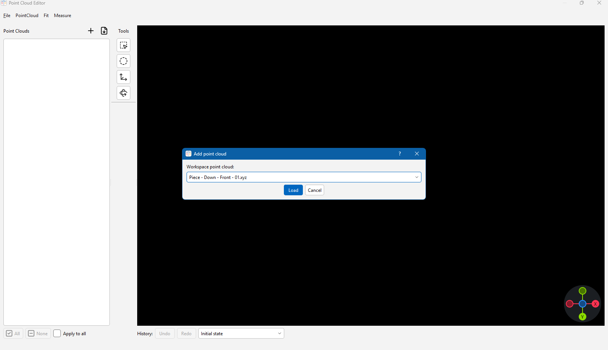 |
| Loaded cloud | 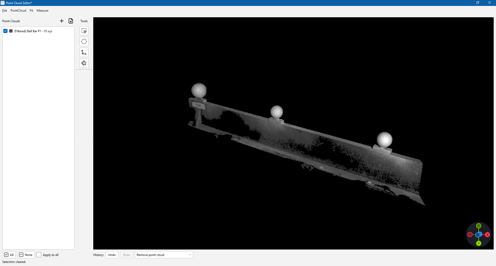 |
| Outlier comparison | 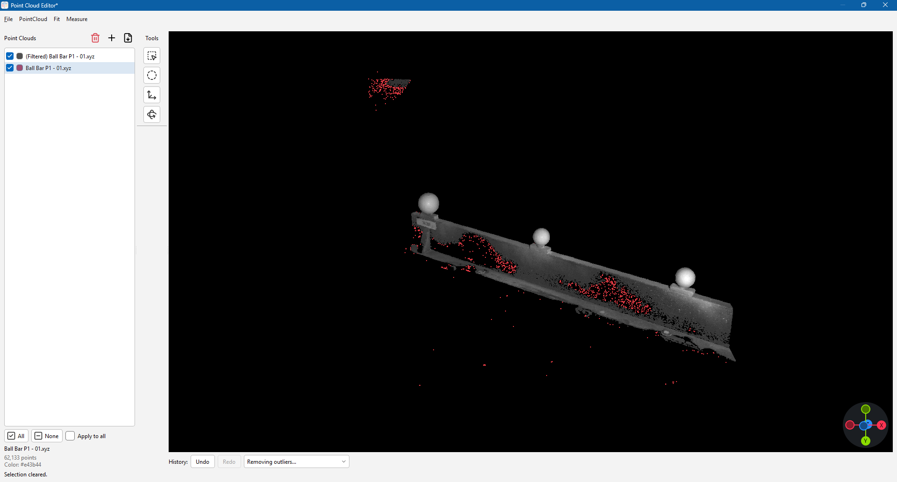 |
| Plane fitting | 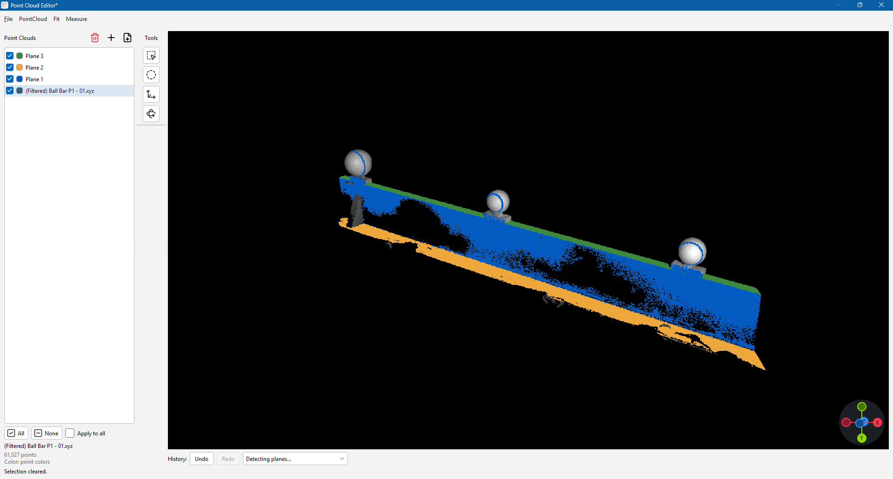 |
| Sphere fitting | 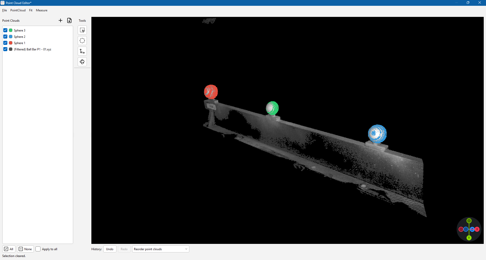 |
| Scans selected for measuring | 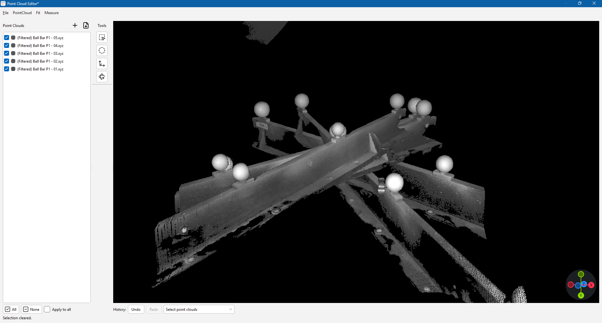 |
| Measure Spheres | 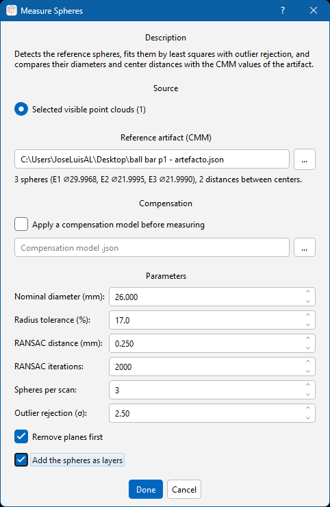 |
| Sphere Measurements | 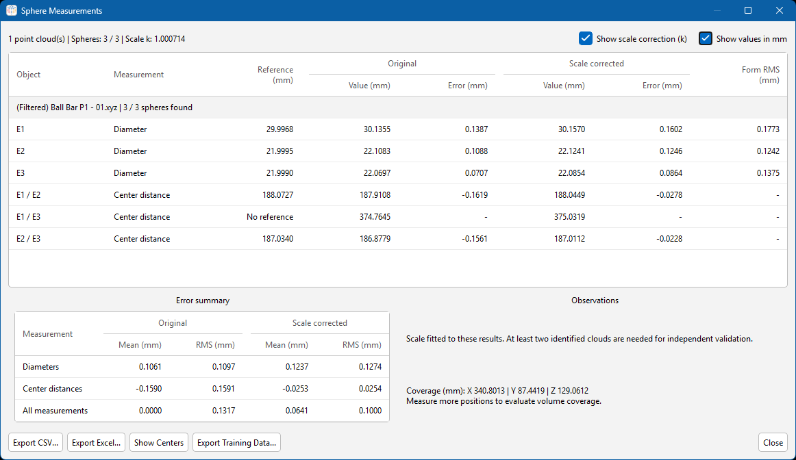 |
| Measured spheres as layers | 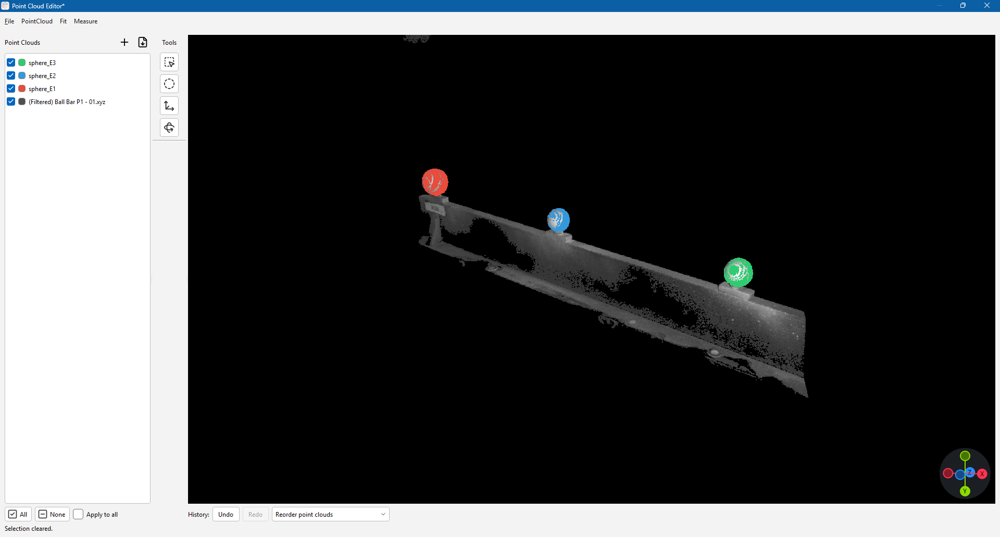 |
