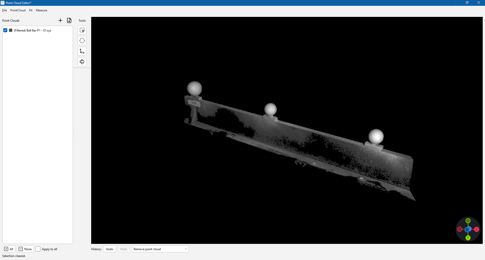
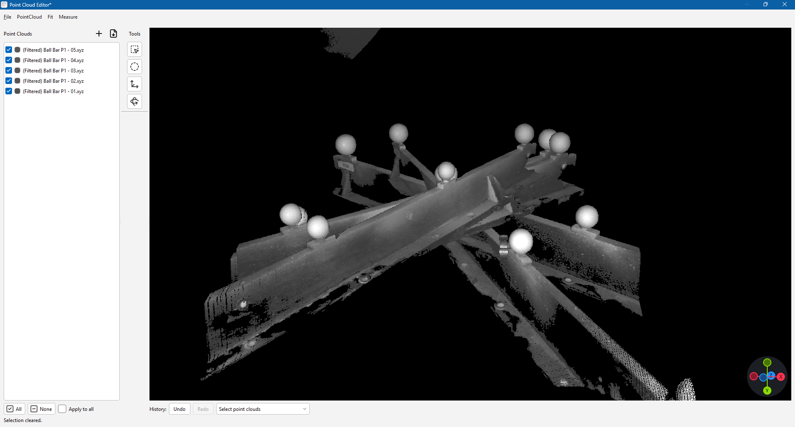
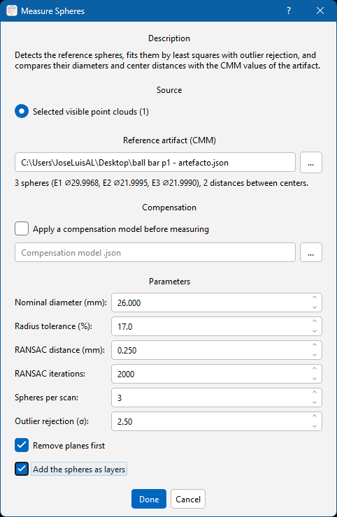
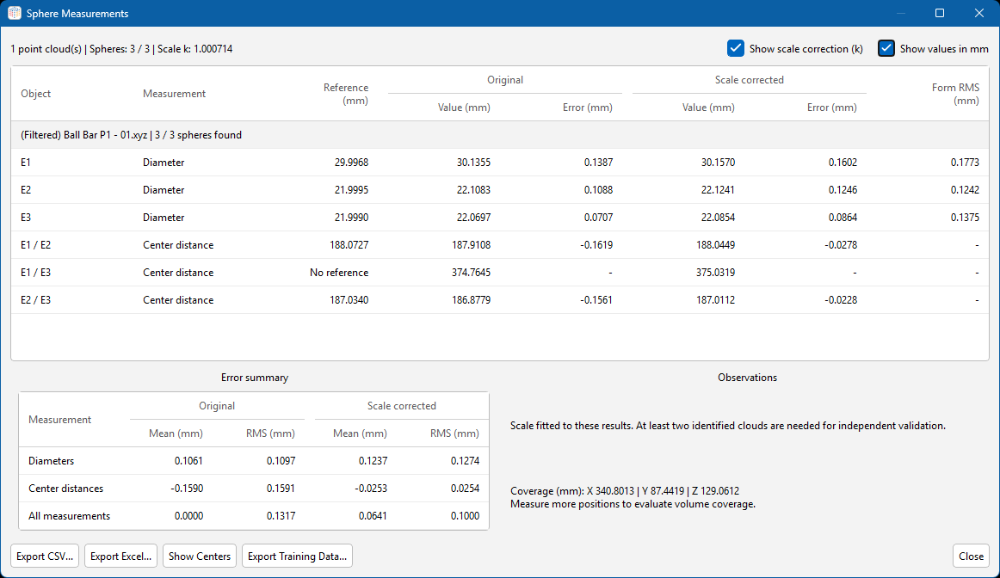
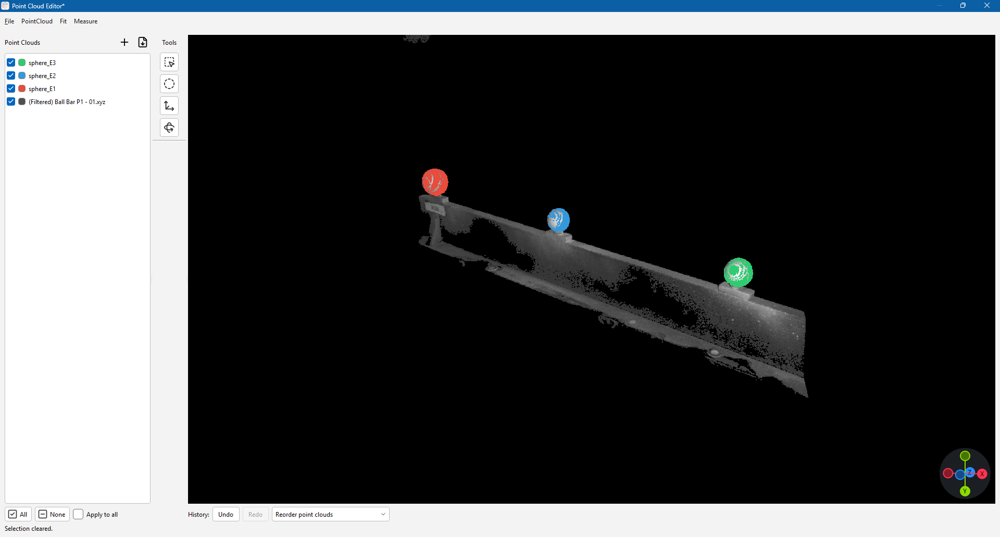

# User guide

This guide covers the normal SMCP workflow: choose a workspace, acquire or load Gray-code
captures, calibrate a projector-camera pair, reconstruct a point cloud, and inspect or edit
XYZ files.

Build the program first by following [BUILD.md](BUILD.md). A direct camera connection is
optional for processing existing data but requires a build with Spinnaker enabled.

## Concepts and data layout

A **workspace** is a directory that contains one subdirectory per capture set. A capture
set represents one board or object pose and contains the numbered Gray-code images plus a
`projector_info.txt` file. The main window lists these subdirectories and lets you select
which sets participate in decoding, corner extraction, and calibration.

XYZ files placed directly in the workspace are available to the Point Cloud Editor.
Calibration is stored separately as OpenCV YAML.

```text
workspace/
  capture-01/
    cam_01.png
    cam_02.png
    ...
    projector_info.txt
  capture-02/
    ...
  reconstructed-part.xyz
```

## Use the example workspace

SMCP provides a data-only `examples` branch with five complete capture sets, a saved
calibration, and three XYZ point clouds. Clone it into a separate directory:

```powershell
git clone --branch examples --single-branch https://github.com/JoseLuis-AL/SMCP.git SMCP-examples
```

Start an SMCP executable built from `main`, click **Directory**, and select the root
`SMCP-examples` directory as the workspace. The five timestamped directories appear as
capture sets, while the three XYZ files become available in the Point Cloud Editor.

For the supplied captures, configure 22 by 15 interior corners and a square size of 15 by
15. Run **Decode**, **Extract Corners**, and **Calibrate** in that order. You can then
select a decoded set and run **Reconstruct**, or load the supplied `calibration.yml` to
test reconstruction without recalibrating.

See [Example datasets](EXAMPLES.md) for the complete file inventory, expected editor
tests, and detailed validation workflow.

## First launch

1. Start `SMCP_d.exe` for Debug or `SMCP.exe` for Release from the generated `bin`
   directory.
2. Click **Directory** in the Workspace section and choose a workspace.
3. Enter the checkerboard's interior corner count and physical square width and height.
   Use one consistent physical unit, normally millimetres; reconstructed coordinates use
   that same unit.
4. Set the Decode, Calibration, and Reconstruction controls. The built-in defaults are a
   practical starting point.

Settings are saved automatically for the current Windows user.

## Hardware preparation

For reliable calibration and reconstruction:

- mount the camera and projector rigidly; do not move either device after calibration;
- focus both devices at the intended working distance;
- disable automatic exposure, gain, gamma, white balance, and focus at the device level;
- avoid saturation in both the light and dark projected frames;
- use a flat checkerboard with accurately known square dimensions; and
- reduce ambient-light changes and motion during each pattern sequence.

The projector must be connected as a Windows display. Extend the desktop to it instead of
mirroring when the displays have different resolutions.

## Capture a data set

The **Capture** action is available only in builds configured with
`SMCP_WITH_SPINNAKER=ON`.

1. Open **Capture** and choose the projector screen and camera.
2. Choose the pattern count. More Gray-code levels provide a larger addressable projector
   range but require more frames.
3. Use **Alignment Mode** to position the board or object within the shared camera/projector
   field of view.
4. Adjust black level, gain, gamma, exposure time, and the wait between patterns. The gray
   statistics help detect underexposure or clipping.
5. Set **Output directory** to the workspace where capture sets should be created.
6. Click **Capture** and keep the scene still until the progress completes.
7. Repeat for multiple checkerboard poses. Cover different image regions, angles, and
   depths while keeping every complete set sharply visible.

SMCP creates a timestamped subdirectory and writes its `cam_NN.png` sequence and projector
metadata there. The Workspace tree is rescanned automatically when capture finishes.

## Calibrate the system

Select the desired capture sets in the Workspace tree. **All** and **None** provide quick
selection controls.

1. Click **Decode** to convert the Gray-code frames into camera-to-projector
   correspondences.
2. Click **Extract Corners** to locate and refine the checkerboard corners.
3. Inspect **Image View**, **Pattern View**, and **Projector View**. Exclude sets with poor
   corner detection, motion, saturation, or large undecoded regions, then rerun the needed
   operations.
4. Click **Calibrate**. SMCP calibrates the camera and projector and estimates their relative
   pose.
5. Use **Calibration > Display...** to inspect the matrices and reprojection errors.
6. Use **Calibration > Save...** to save the result as YAML.

An existing calibration can be restored with **Calibration > Load...**. The expected file
shape is illustrated by [samples/sample_calibration.yml](samples/sample_calibration.yml).

### What the window tells you

- **Action buttons** are enabled only when they can run. Calibrate needs at least three selected
  sets and Reconstruct needs a calibration; the tooltip of a disabled button says what is
  missing. Ctrl+1 to Ctrl+6 trigger the actions in the order of the column.
- **The dot beside each set** summarizes it: blue when its chessboard was found or it is decoded,
  red when the chessboard was searched for and not found, green when the set took part in the
  last calibration. The tooltip of the set lists the same in words.
- **The status bar** shows, at the right, the calibration in use and its stereo error, or
  "No calibration loaded".
- **The processing dialog** closes by itself when Extract Corners or Decode end without
  problems. It stays open, with the lines in red or amber, when there is an error, a warning, a
  set without chessboard or a cancellation. After Calibrate it always stays open so the results
  can be read.

### Parameter guidance

| Control | Effect | Adjustment guidance |
|---|---|---|
| Inner corners | Interior corners of the chessboard, columns x rows | One less than the number of squares on each side |
| Square (mm) | Width and height of one square | Reconstructed coordinates use the same unit |
| Apply threshold | Minimum contrast (0-255) a pixel needs to be used in the pattern and projector views and in the reconstruction | Raise it to reject noisy low-contrast pixels; lower it if valid dark areas disappear. The button refreshes the projector view. It does not affect decoding or calibration |
| Black level (b) | Black-light ratio used by robust direct-light estimation | Keep it between 0 and 1; start with `0.5` |
| Min. direct light (m) | Minimum direct-light component in Gray-code levels | Raise it when indirect light causes false codes; start with `5` |
| Corner window (px) | Side of the window around each camera corner whose decoded pixels map it to the projector | The default `60` is a starting point; use a window large enough to contain stable decoded pixels around each corner. A corner closer to the image border than the window stops the calibration with a message |
| Joint refinement | Refines the camera, the projector and their relative pose together in the last step of the calibration | Off by default (the classic method keeps the camera and the projector as calibrated separately). It applies to the next calibration. See [Joint refinement](#joint-refinement) |
| Sub-pixel corners | Locates the chessboard corners in the projector with sub-pixel projector coordinates | Off by default. It applies to the next calibration, which reads the images of every set once more. See [Sub-pixel corners](#sub-pixel-corners) |
| Max. ray distance (mm) | Maximum separation between camera and projector rays | Lower values reject uncertain triangulations; the value uses the unit of the square size |
| Projector-plane triangulation | Computes each point where the camera ray meets the plane of light of its projector column | Off by default. See [Projector-plane triangulation](#projector-plane-triangulation) |
| Sub-pixel (camera resolution) | Reconstructs one point per camera pixel instead of one per projector pixel | On by default; uncheck it for the classic method. See [Sub-pixel reconstruction](#sub-pixel-reconstruction) |

Changing **b** or **m** makes the next operation decode the sets again; the other parameters
reuse the decoded data. Change one parameter at a time and evaluate the resulting
correspondence views and errors.

### Joint refinement

The classic calibration solves the camera alone, then the projector alone, and finally only their
relative position, keeping what it found for each device. With **Joint refinement** checked, that
last step adjusts everything together over all the sets.

It was compared with the classic method on four workspaces by calibrating without some sets and
reconstructing the chessboard corners of those sets:

| Workspace | Error of the distances between corners, classic | With joint refinement |
| --- | --- | --- |
| Experimento old (25 boards) | 241 um | 239 um (-1 %) |
| Experimento 02 (10 boards) | 162 um | 110 um (-32 %) |
| Experimento 03 (11 boards) | 277 um | 269 um (-3 %) |
| Experimento 04 (7 boards) | 136 um | 113 um (-17 %) |

It was never worse on distances; the flatness of the reconstructed boards changed by a few
percent in either direction. Calibrate again after checking it and save the calibration: point
clouds, compensation models and measurements made with the previous calibration are not changed.
`SMCP_calibration_compare <workspace>` repeats this comparison on any workspace whose corners
have been extracted.

### Sub-pixel corners

To calibrate the projector, the program finds where each chessboard corner falls in the projector
image, from the decoded pixels around the corner. With **Sub-pixel corners** checked it uses the
fractional projector coordinates of those pixels (the ones of the sub-pixel reconstruction)
instead of whole projector pixels.

| Measured on | Classic | Sub-pixel corners |
| --- | --- | --- |
| Experimento old, boards left out of the calibration: flatness | 114 um | 76 um |
| Same boards: gap between the camera ray and the projector ray | 39 um | 28 um |
| Same boards: error of the distances between corners | 241 um | 234 um |
| Experimento 04, boards left out: distances between corners | 136 um | 133 um |
| Ten ball-bar captures: RMS diameter error | 86 um | 85 um |
| Ten ball-bar captures: RMS error of the center distances | 163 um | 162 um |

It made the reconstructed boards flatter in the setup where a projector pixel covers about two
camera pixels, and changed almost nothing where it covers 3.5. On the spheres it made no
difference worth noting.

## Reconstruct a point cloud

1. Load a valid calibration if the current session has not just produced one.
2. Select one capture set in the Workspace tree (it is decoded first if needed).
3. Choose whether the output should include **Export normals (PLY)** and **Export colors**.
   Normals are written only to PLY files.
4. Optionally check **Compensate** to correct the reconstruction with a compensation model (see
   [Compensate reconstructions](#compensate-reconstructions)).
5. Leave **Sub-pixel (camera resolution)** checked, or uncheck it for the classic method (see
   [Sub-pixel reconstruction](#sub-pixel-reconstruction)).
6. Click **Reconstruct**.
7. Choose XYZ, ASCII PLY, or binary PLY in the save dialog. Cancelling it keeps the cloud in
   memory without saving.

### Sub-pixel reconstruction

The classic method gives one point per projector pixel: it averages the camera pixels that saw
that projector pixel. With **Sub-pixel (camera resolution)** checked, every camera pixel gives
its own point. The program locates, between camera pixels, the borders of the projected stripes
and interpolates the projector position of each pixel from them.

- **Density.** The cloud has as many points as lit camera pixels: about 10 times more than the
  classic method when a projector pixel covers 3.5 x 3.5 camera pixels, about 3 times more when
  it covers 1.7 x 2.1. Files and editing times grow accordingly.
- **Noise.** On the flat chessboards of two workspaces, the scatter around a plane fitted to
  small patches dropped by about 20 % and 35 %. It does not correct errors of the calibration
  or of the projector, which affect both methods alike.
- **Time.** The images of the set are read again, which adds a fraction of a second.
- **Spheres.** Ten ball-bar captures were reconstructed both ways and measured against the CMM
  values: the RMS diameter error went from 122 um to 86 um and the form RMS from 151 um to
  112 um, with about 3.3 times more points on each sphere. The distances between centers did not
  change (165 um and 163 um). The diameter improved in 7 of the 10 captures and got worse in 3.
- **Reconstruct from Dump...** has no images, so it always uses the classic method.
- **Compensation models** trained on classic reconstructions were not validated with sub-pixel
  clouds. Train the model again on sub-pixel clouds, or compare both before relying on the
  combination.

### Projector-plane triangulation

The classic method takes, for each point, the middle of the shortest segment between the ray of
the camera pixel and the ray of the projector pixel. It uses the projector column and the
projector row, although only the column changes with depth when the projector is beside the
camera. With **Projector-plane triangulation** checked, the point is where the camera ray meets
the plane of light of the projector column; the row no longer moves it. (For a projector above
or below the camera the roles of column and row are exchanged automatically.)

On the ten ball-bar captures, with the sub-pixel reconstruction, it did not help: the form RMS
stayed at 112-113 um, the center distances at 163 um, and the diameters grew by about 35 um
(mean error from +34 um to +69 um, RMS from 86 um to 97 um). It is offered to be tried on other
setups, in particular those where the projector rows are noisier than the columns.

The sub-pixel option is checked by default in a new installation. A computer that already ran a version
with the option keeps the choice it had saved. The calibration, the decoding and the classic
reconstruction are not affected by it.
7. Open **3D View** to inspect the result.

Mouse controls in the 3D views are:

| Input | Action |
|---|---|
| Left-button drag | Orbit around the cloud |
| Middle-button drag | Pan |
| Mouse wheel | Zoom |

If reconstruction produces sparse or noisy geometry, first inspect Pattern View for holes,
then review Threshold and Max. ray distance. A bad calibration cannot usually be repaired by
loosening reconstruction thresholds; recapture problematic calibration poses instead.

## Point Cloud Editor

Click **Point Cloud** to open the editor. The **Point Clouds** panel is on the left.
Use **+** in its header to open the workspace XYZ selector. Choose one file and accept to add
it, or cancel without changing the editor. The chooser is resizable with a 600-pixel minimum
width and centered **Load**/**Cancel** buttons of equal width. A file without points produces a
**No points** dialog. The adjacent download icon exports selected clouds.



### Select point clouds

The panel is a tree with one row per cloud, like the Workspace tree of the main window. Each
row has a check box, a color square and the name of the cloud.

- **Check box:** a checked cloud is shown, an unchecked one is hidden. **All** and **None**,
  under the tree, check or uncheck every cloud at once.
- **Highlight:** click a row to highlight it. Ctrl-click adds or removes rows; Shift-click
  highlights from the row clicked before to this one. Highlighting several rows also checks
  the hidden ones among them, so the group is ready to work on; highlighting a single hidden
  row leaves it hidden.
- **Apply to all:** this box, beside **All** and **None**, decides which clouds a command works
  on. Unchecked (the default), commands use the highlighted clouds that are checked. Checked,
  they use every checked cloud, whichever row is highlighted.

Processing, AI models, export, merging and the editing tools all use those clouds. A hidden
(unchecked) cloud never takes part.

- **Color:** click the color square to recolor the preview.
- **Rename:** double-click the name.
- **Reorder:** drag rows to change the drawing priority; the top row takes priority where cloud
  pixels overlap.
- **Delete:** press **Del** (or the trash button of the header) to remove the highlighted
  clouds, hidden ones included; with **Apply to all** on, it removes every checked
  cloud. A confirmation always appears, and the removal is one undoable command.

Checking or unchecking clouds, one at a time or all at once, is one step of the history.

Parameters are chosen once and applied independently to each selected cloud. ICP requires at
least two selected clouds and uses the topmost selected cloud as its reference. Processing results
remain separate from their inputs. Command actions and the panel are locked while a job runs.

The menu bar groups these commands as follows:

- **PointCloud:** Remove Outliers, Align Centroids, Register (ICP), and the dynamic **AI Models** submenu.
- **Fit:** Plane and Sphere.
- **Measure:** Spheres and Compensate.

Each action opens the same parameter dialog and runs the same operation as before. Menu actions
have no persistent selection, so they can be used again immediately after cancelling a dialog.

### Save and reopen an editor project

Use **File > Open Project...** (`Ctrl+O`) and **File > Save Project** (`Ctrl+S`) in
the editor's menu bar.
Save creates a self-contained `.smcppce` file with all layers and point colors, their names, order,
visibility, point and layer selections, the current camera view, and the retained history of up to
50 commands. The position in that history is saved too, so Undo and Redo work after reopening.
Original XYZ files and AI models are not needed to restore already computed results.

The first save opens a file picker. Subsequent saves update that project atomically. Opening a
project asks before replacing a nonempty session; cancel leaves the session intact. Damaged or
unsupported files are refused before the live scene is replaced. Saving and loading run on workers.
Point data shared between history states is stored once; geometric edits retain their earlier
point versions, so projects with many large edits can take more disk space.

### Combine selected clouds

With two or more visible clouds selected, a **Merge selected point clouds** icon appears just
left of Add in the Point Clouds header. Click it to replace the selected layers with one cloud,
named **(Merged) X** using the first selected name. The result occupies that first selected
position and becomes selected. Other layers keep their order; hidden clouds are ignored.
The merge concatenates the original XYZ/RGB data without alignment or deduplication. Preview-only
color overrides are not baked into the points. Undo restores all original layers and selections.

With **two or more** visible clouds selected, a red **Delete selected point clouds** icon appears
next to Merge. Confirming removes the selected clouds together; one Undo restores the whole batch.
Hidden layers and files on disk are unaffected.

### Remove outliers

1. Make the cloud to filter the selected cloud.
2. Choose **PointCloud > Remove Outliers**.
3. Set **Neighbors (k)** and **Standard deviation multiplier**.
4. Click **Done** to run or **Cancel** to leave the cloud unchanged.

The operation removes points whose mean neighbor distance is above the global mean plus the
chosen number of standard deviations. A smaller multiplier removes more points; a larger
neighbor count smooths the density estimate but costs more processing time.

Each filtered result is inserted at the top of the Point Clouds panel as **(Filtered) X**,
where X is its input cloud's full name. The input keeps its name and remains in the list,
recolored red for comparison. Select the result before applying another command to it.

### Align cloud centroids

Select two or more visible clouds, then choose **PointCloud > Align Centroids**.
The first selected cloud in panel order is the reference and stays
fixed. The other selected clouds are translated until their centroids coincide with its
centroid. Names, point colors, and each cloud's shape are preserved; hidden and unselected
clouds are ignored. The whole operation is one undoable command.

### Fit planes or spheres

Choose **Fit > Plane** or **Fit > Sphere**.

- Plane parameters control the number of planes, RANSAC iterations, point-to-plane distance,
  minimum inliers, and coefficient refinement.
- Sphere parameters add minimum and maximum radius and use a point-to-surface distance.
- A minimum-inlier value of **Automatic** derives a threshold from the cloud size.
- **Done** starts the fit; **Cancel** makes no change. Either action can be selected again.

The fit uses the selected cloud. When it finds models, every existing row is hidden and each
detected model is added as a separate colored cloud (**Plane 1**, **Sphere 1**, ...). Check
the original clouds again to show them. Sphere fitting first removes dominant planes
internally so planar backgrounds are less likely to overwhelm the sphere search; the status
bar reports each sphere's center, radius, and point count.

### Register and merge point clouds (ICP)

ICP (Iterative Closest Point) aligns overlapping scans of the same object and merges them.

1. Select at least two visible clouds. The first selected cloud in panel order is the reference.
2. Hidden and unselected clouds are ignored. **Register (ICP)** stays disabled with fewer than two selections.
3. Choose **PointCloud > Register (ICP)** to open **ICP: Iterative Closest Point**, adjust the parameters, and
   click **Done**. **Cancel** adds no results and does not change history.

| Parameter | Meaning |
| --- | --- |
| Maximum iterations | Upper limit of transform updates for each cloud |
| Maximum pair distance | Pairs of closest points farther apart are ignored, in cloud units; **No limit** disables it |
| Overlap ratio | Fraction of the closest pairs used in each iteration; lower it when scans overlap only partially |
| Convergence threshold | Stops when the relative change of the RMS error falls below this value |
| Sampled points | Points of each cloud used to estimate its motion (**All** uses every point); the whole cloud is moved |
| Point-to-plane distances | Converges faster on smooth surfaces; clear it to use point-to-point distances |
| Align centroids first | Moves each cloud's center onto the target's before iterating |
| Align each cloud to the clouds already merged | Registers each cloud against the reference plus the clouds aligned before it, which helps when scans overlap only their neighbors |

ICP refines an approximate alignment: the clouds must overlap and start close to their final
position, otherwise it can converge to a wrong pose. Remove outliers first for better results.

When at least one cloud registers, the reference and each aligned cloud are added in distinct
colors for comparison. Their names are **(ICP) (Reference) X** and **(ICP) (Aligned) X**, using
the respective original cloud name. Their union is prepended as **(ICP) (Merged) X**, using the
reference name. Inputs keep their original names and data. All outputs form one undoable command.
The status bar reports RMS error, iteration counts, and clouds that did not converge or failed.

### Measure reference spheres

**Measure Spheres** measures an artifact of reference spheres, such as three 100 mm spheres also
measured on a CMM, to evaluate the system and to collect data for a compensation model.

#### Workflow: from the scans to the measurements

This is the complete sequence to obtain the diameters and center distances of a sphere artifact,
from reconstructed scans to an exported report. The example uses three scans of an artifact with
three 16 mm spheres measured on a CMM.

1. **Prepare the reference artifact.** Write a JSON file with the calibrated diameters and
   center distances, in mm, following [samples/sample_artifact.json](samples/sample_artifact.json):

   ```json
   {
     "name": "Three-sphere artifact",
     "spheres": [
       { "name": "FRONTAL", "diameter": 15.997 },
       { "name": "IZQ", "diameter": 15.997 },
       { "name": "DER", "diameter": 15.997 }
     ],
     "distances": [
       { "from": "FRONTAL", "to": "IZQ", "value": 53.0992 },
       { "from": "FRONTAL", "to": "DER", "value": 53.0677 },
       { "from": "IZQ", "to": "DER", "value": 74.8377 }
     ]
   }
   ```

   The file is optional: without it the spheres are measured, but they are not labeled or
   compared with a reference.
2. **Reconstruct the scans.** Calibrate, select each capture set of the artifact, click
   **Reconstruct** and save every cloud as `.xyz` in the workspace
   (see [Reconstruct a point cloud](#reconstruct-a-point-cloud)).
3. **Open the editor and add the scans.** Click **Point Cloud**, then **+** in the Point Clouds
   panel once per scan.
4. **Keep only the region of the spheres.** Detection searches the whole cloud, and a sphere is
   accepted only when it holds at least 1 % of the points that remain after removing the planes.
   In a scan of the complete scene the spheres are a small fraction of the points and may not be
   found (**0 / 3 spheres found**). Use [Select](#select-and-delete-points) to delete the fixture,
   the table and the background, leaving the spheres and a little of their supports;
   **PointCloud > Remove Outliers** removes isolated points.
5. **Select the scans to measure.** Click the first row and Shift-click the last one; every
   highlighted, visible cloud is measured as one scan of the campaign.

   

6. **Choose Measure > Spheres.** Browse to the artifact file; the line below it summarizes what
   was read and **Spheres per scan** takes its number of spheres. Set **Nominal diameter** to the
   diameter of the spheres and leave the other parameters at their defaults for a first run.
   Click **Done**.

   

7. **Read the results.** The **Sphere Measurements** window opens when the fits finish. Every
   scan has a header with the spheres found, one row per diameter and one row per center
   distance, each with its reference, measured value and error. **Error summary** gives the mean
   and RMS error of the campaign, and the title line gives the scale factor *k*. Check
   **Show values in mm** to change the units and **Show scale correction (k)** to add the
   corrected values.

   

8. **Export.** **Export Excel** or **Export CSV** writes the table that is displayed, in the
   selected units; **Export Training Data** writes the dataset for a compensation model.
9. **Check the fits in the viewer.** After closing the window, the points used by every fit are
   in the Point Clouds panel as layers named after the spheres of the artifact, drawn in the
   color of each label. A sphere fitted on the wrong surface is visible here.

   

If a scan reports fewer spheres than expected, crop it closer to the spheres, raise
**RANSAC iterations**, or widen **Radius tolerance**; if a sphere is fitted on a support, crop
the support or lower **Radius tolerance**. The sections below describe every parameter and result.

#### Reference

1. Select the visible clouds to measure in the Point Clouds panel. Load several scans to measure a campaign.
2. Choose **Measure > Spheres**. The same command can be selected again after cancelling.
3. Optionally choose the reference artifact, a JSON file with the CMM diameters and center
   distances; [samples/sample_artifact.json](samples/sample_artifact.json) shows the format.
   Loading it sets **Spheres per scan** to its number of spheres.
4. Adjust the fields in **Parameters**, below **Compensation**, and click **Done**. The dialog
   groups its overview under **Description**; **Done** and **Cancel** are centered and equally wide.

| Parameter | Meaning |
| --- | --- |
| Nominal diameter | Diameter of the spheres to detect, in mm |
| Radius tolerance | Detection accepts radii within the nominal radius plus or minus this percentage |
| RANSAC distance | Distance to the surface that counts during detection; the final fit uses points up to three times this distance |
| RANSAC iterations | Detection attempts per sphere |
| Spheres per scan | Number of spheres to detect |
| Outlier rejection (σ) | The fit is repeated without the points farther from the surface than this many standard deviations (2.5 by default) |
| Remove planes first | Removes the table and background before detecting |
| Add the spheres as layers | Adds the points of every fitted sphere as a layer (**sphere_A**, **sphere_B**, ...). Uncheck it to open only the results table and leave the layers as they are, for example when measuring many scans |

Each sphere is fitted by geometric least squares, the distance of every point to the surface.
With an artifact, the spheres are labeled by the names in the file, choosing the assignment whose
center distances and diameters best match the CMM values; without one they are named S1, S2, ...
by increasing X.

The results window groups measurements by cloud, with one row per sphere diameter and one row
per distance between centers. Columns show the reference, original value and error, scale-corrected
value and error, and the sphere's original form RMS (distance of its points to the fitted surface).
All dimensional values default to µm. **Show values in mm** changes the entire window and CSV export
to mm, including errors, form, coverage and validation. Counts and the scale factor have no units.
**Show scale correction (k)** reveals corrected values and statistics alongside the originals,
without tabs. It starts unchecked and is disabled when no valid reference comparisons are available.
Unchecking it hides the corrected columns; original measurements and the unit selection are preserved.

Below the table, **Error summary** compares the mean and RMS errors for diameters, center distances
and all valid reference comparisons. **Observations** contains validation, coverage and compensation
notes. Missing measurements or references are explicit and excluded from error statistics. Unidentified
spheres keep their measured values under neutral names, without inventing artifact matches or errors.
When the source is the selected visible clouds, each fitted sphere is also added as a layer
(**sphere_A**, **sphere_B**, ...).

The window also analyzes the campaign:

- **Fixed scale correction.** With an artifact, it fits the single factor *k* that best corrects
  every diameter and center distance of the labeled scans (least squares), and gives the RMS error
  before and after it. With two or more scans containing valid reference comparisons it also gives
  the error when each scan is corrected with the factor fitted on the others, which estimates the
  error on a new scan. When diameters and
  distances keep clearly different errors after it, the reconstructed volume is deformed rather
  than just scaled, and a position-dependent compensation is needed.
- **Coverage.** The range of the sphere centers along X, Y, and Z, in the camera frame of the scans
  (X to the right, Y down, Z in depth), and the correlation between those axes. It warns when an
  axis varies less than two sphere diameters, or when two axes change together (|r| of 0.9 or
  more), as happens when a tilted camera looks at the artifact moved only across the table: a model
  trained on such data cannot tell the effect of one axis from the other. Capture more positions
  until the warning disappears.
- **Show Centers** adds the layer **sphere_centers**, with a small sphere at every measured
  center in the color of its label, to see which part of the volume the campaign covers.

- **Export CSV** writes the original measurements, one row per scan, with centers, diameters,
  form errors (RMS and peak to valley), point counts, center distances, and their errors.
  Every dimensional column uses the selected unit, with `_um` or `_mm` in its header and `.`
  as the decimal separator. Existing files cannot be overwritten.
- **Export Excel** writes an `.xlsx` workbook with the displayed object rows grouped by cloud,
  the error summary and observations on one worksheet. It uses the selected µm or mm units;
  corrected columns are included only when **Show scale correction (k)** is checked. Numeric
  results are Excel numbers, with readable column widths and frozen headers. Export runs in the
  background, requires no installed copy of Excel, and cannot overwrite existing files.
- **Export Training Data** writes, per scan, `<scan>.spheres.xyz` with the points kept by each
  fit and their label (`x y z label`), plus `manifest.json` with the artifact and the fitted
  spheres, plus the fixed scale *k* as `fixed_scale`. This is the dataset a compensation model is
  trained on. Its points and manifest retain mm regardless of the display checkbox, so use raw reconstructions:
  clouds that were moved, rotated, or aligned in the editor are no longer in the camera frame.
  The `pinn-smcp` trainer in WSL trains a compensation model on this folder; see the
  [WSL models quick start](WSL_MODELS_QUICKSTART.md#train-the-smcp-compensation-pinn).

### Compensate reconstructions

A compensation model corrects the systematic error of the structured-light system point by point.
It is trained in WSL by the `pinn-smcp` trainer on a campaign measured with **Measure Spheres**
(see the [WSL models quick start](WSL_MODELS_QUICKSTART.md#train-the-smcp-compensation-pinn)) and
saved as a `.json` file. It only applies to raw reconstructions in the camera frame, made with the
same calibration it was trained with.

SMCP reads the model and checks it against test points computed by the trainer: a model this
version cannot reproduce exactly is refused. Points beyond the volume covered by the training
spheres receive the physical correction, and the network part fades out over a margin of 10 % of
that volume.

Three places apply a model:

- **Reconstruction, main window.** Check **Compensate** in the Reconstruction group; the first
  time, choose the model with **Model...**, which shows its training summary. Every reconstruction
  is then corrected before normals are computed and before saving. When the model records a
  calibration and the current calibration file differs, SMCP asks whether to apply it anyway,
  skip it, or cancel the reconstruction.
- **Measure > Compensate, point cloud editor.** Corrects the selected visible clouds and inserts the result at the top as
  **comp_<name>**. Before applying, a dialog shows the model's training scans, its cross-validated
  errors (fixed scale, physical block, PINN), a warning if the PINN was not better than the fixed
  scale, and whether its calibration matches `calibration.yml` in the workspace. The status bar and
  the layer tooltip report how many points lay outside the trained volume.
- **Measure Spheres.** Check **Apply a compensation model before measuring** and choose the model
  to correct every scan before it is measured. Measure a campaign the model was not trained on to
  evaluate it: the results window then starts with "Compensated with <model>".

### Run an AI model

AI models are optional. They run in Ubuntu 22.04 under WSL and require the setup described
in [WSL models quick start](WSL_MODELS_QUICKSTART.md). Users who do not need them can ignore
the **PointCloud > AI Models** submenu; the rest of the editor works the same without WSL.

When the editor opens, SMCP searches the validated `~/smcp-models/models.json` registry in
WSL. The submenu shows **Searching...** and stays disabled until the search finishes, which
can take a few seconds while WSL starts. If no model is found, or WSL is unavailable, the
submenu remains disabled and its tooltip explains why. Close and reopen the editor to search
again, for example after finishing the WSL setup.

1. Make the input cloud the selected cloud.
2. Select `Score Denoise`, `StraightPCF`, or `PointCleanNet` from **PointCloud > AI Models**.
3. Read **Description** and edit the JSON under **Parameters**, shown in Cascadia Mono.
   The parameter editor keeps its white background on hover. The dialog checks names, types, enumerated values,
   and ranges while you type, and **OK** is available only for a valid configuration.
4. Click **OK** to start inference. The **Running AI Model** window shows the CPU/AI icon, **Thinking**,
   the current cloud's name and point count, a **Progress** section, the elapsed time,
   and the latest message reported by the model, and blocks the editor
   until the model finishes.
5. When inference finishes, the result is added to the layer panel with the registered suffix,
   for example `example_piece_score_denoise.xyz`.

With several clouds selected, the model runs on each of them with the same configuration, one
after another, in the order of the selection:

- The window shows which cloud is being processed (**Cloud 2 of 5**), and the status line counts
  the clouds finished so far.
- The clouds are not processed at the same time: the models share one graphics card, and two
  running together can exhaust its memory.
- If the model fails on one cloud, that cloud is skipped and the batch continues. The status line
  ends with the clouds that could not be processed and the reason given by the model.
- **Cancel** stops the batch. The cloud in progress is discarded; the clouds already processed
  are kept.
- All the results are added together when the batch ends, as one command: a single Undo removes
  them all.

Selecting a model always opens its configuration, including after a previous run finishes,
fails or is cancelled, and after cancelling the configuration dialog itself.

Click **Cancel** in the **Running AI Model** window, or close that window, to stop the model.
The model process in WSL is terminated and its partial result is discarded. Escape does not
cancel, to avoid stopping a long run by accident.

Accepted settings are remembered per model while the editor remains open: select the same
model again to run it with the previous parameters or change them. Some models reject very small
clouds; PointCleanNet, for example, needs enough points to fill its processing cells.

#### Which parameters matter when measuring

The models reduce the scatter of the points, but they can also move a surface as a whole, which
changes a measured diameter. The notes below come from ten ball-bar scans (40 000 to 104 000
points, 0.49 mm between points, 1000 to 1900 points per sphere, form RMS about 150 um) measured
against their CMM values before and after each model. Repeat the comparison with
`SMCP_measure_spheres` when the scanner setup or the density of the clouds changes.

| Model | What to set | What was observed |
| --- | --- | --- |
| StraightPCF | `cluster_size` 2000 to 3000 (default 3000), `niters` 2 | Form RMS from about 150 um to 65-95 um. Larger clusters and more iterations shrink the spheres: about -170 um on the diameter with `cluster_size` 10000, about -300 um with 20000 |
| Score Denoise | Not recommended before measuring | Form RMS drops to 65-90 um, but diameters grow by 60 to 250 um with every `cluster_size` tried |
| PointCleanNet | Defaults | Form RMS drops only 5-10 %, diameters barely change, and it takes 3 to 5 minutes per cloud |

- With StraightPCF at `cluster_size` 3000 the mean diameter error of those scans went from +87 um
  to +14 um. Part of that is the model's shrinkage cancelling a bias the scans already had, so it
  is not proof that the surface is more faithful.
- Center distances are not improved by any of the three models; that is the job of the
  compensation.
- For clouds above `large_threshold` (20 000 points) the cloud is split into groups of
  `cluster_size` points and only that parameter (and `niters` for StraightPCF) reaches the model:
  `ld_step_size`, `ld_num_steps`, `step_decay` and `denoise_knn` of Score Denoise, and
  `patch_size`, `seed_k` and `seed_k_alpha` of StraightPCF, have no effect. In PointCleanNet,
  `target_points_cell` stops having an effect once the cell reaches half the smallest side of the
  cloud; set `cell_size` in millimetres to go beyond it.
- A small `cluster_size` can stop a run with an error about `K`: a group ended up with fewer
  points than the model needs (33 for StraightPCF, 17 for Score Denoise), usually an isolated
  fragment. Remove isolated points first (**PointCloud > Remove Outliers**) or raise
  `cluster_size`.

### Manage editor results

The left **Point Clouds** panel shows a check box, a color square and the cloud name on each
row. The details below the tree describe the first cloud the commands will use. Color changes
affect the preview; exported points keep their stored RGB. Unchecked (hidden) clouds must be
checked before editing.

### Rotate a cloud by hand

The vertical **Tools** panel is immediately to the right of Point Clouds. Its icon buttons
are Select, Radial selection, Move, and Rotate. Hover over a button to see its name. To remove an entire cloud,
highlight it in Point Clouds and press Del; that removal can be undone.
**Rotate** helps to align selected clouds by hand, for example to give ICP a close enough
starting position.

1. Select the visible clouds to rotate in the layer panel.
2. Click **Rotate**. A rotation gizmo appears in the viewer, centered on the layer: a red ring
   for the X axis, a green ring for Y, and a blue ring for Z. The rings keep the same size on
   screen when you zoom.
3. Point at a ring (it brightens) and drag along it. The layer turns around that axis and the selection's centroid while you drag; the angle is shown next to the gizmo and in the status bar.
   Hold **Ctrl** to turn in 5° steps.
4. Release the button to apply the rotation to the layer's points. Press **Esc** or click the
   right button before releasing to cancel that drag.

Dragging outside the rings still orbits the camera, so you can look around between drags.
Selecting another layer moves the gizmo to it. Click **Rotate** again to hide the gizmo; it
is also hidden while a command runs.

### Move a cloud by hand

**Move** works like **Rotate** and shares its rules; only one of the two tools is active at a
time.

1. Select the visible clouds to move in the layer panel and click **Move**. The gizmo shows a red
   arrow for X, a green arrow for Y, and a blue arrow for Z, starting at the layer's centroid,
   and a white circle at the centroid. An arrow that points straight at the camera is hidden
   until you orbit.
2. Drag an arrow to move the layer along that axis, or drag the white circle to move it
   freely in the plane of the screen. The gizmo follows the layer, and the offset is shown
   next to it and in the status bar. Hold **Ctrl** to move in whole units.
3. Release the button to apply the offset to the layer's points. Press **Esc** or click the
   right button before releasing to cancel that drag.

### Select and delete points

1. Click **Select** in the **Tools** panel. It turns off **Rotate** and **Move**, and the cursor
   becomes a cross over the viewer.
2. Drag a box with the left button. When you release it, every point of the selected visible clouds
   inside the box is selected and drawn in orange, including points hidden behind others.
   - Hold **Shift** to add the box to the current selection.
   - Hold **Ctrl** to remove the box from the current selection.
   - Click without dragging to clear the selection; **Esc** cancels a box being drawn.
3. Drag with the middle button to orbit the camera without leaving the tool; Shift + middle button
   pans and the wheel zooms.
4. While points are selected, the **Delete selected points** icon appears below the separator
   in **Tools**. Its tooltip shows the selected point count. Click it and
   confirm to remove those points from their layers. Use Undo to recover the points; files on disk
   are not affected. A layer left without points is removed from the panel.

The status bar shows how many points are selected and in how many layers. The selection stays
when you turn **Select** off. Hiding a layer, deleting it, or changing its points with another
tool or command clears that layer's part of the selection.

### Radial selection brush

Click the dashed-circle icon in **Tools**. Hold the left mouse button and paint over the cloud;
the circle shows the brush area and the orange line previews the stroke. **Ctrl + wheel** changes
its radius (4–256 logical pixels, initially 24); it can be resized during a stroke without zooming.
Release the left button to calculate and add the selected points in the background.

The brush adds to the existing selection and never counts an already selected point twice.
It selects all projected points under the stroke, including points behind others, only in selected
visible clouds. Paths are continuous between mouse events. **Esc** or right-click cancels an
unfinished stroke. Each stroke that adds points is one undoable command; repainting an already
selected area adds no command. Camera navigation remains available between strokes.

### Undo, redo, and history

Use **Undo** (Ctrl+Z), **Redo** (Ctrl+Y or Ctrl+Shift+Z), or the history selector in the
History row below the viewport, aligned to the left. The editor retains up to 50 commands, including adding/removing clouds, selecting
clouds or points, deleting points, moving/rotating, changing visibility/color/name/order, and
applying algorithms or AI. A method applied to several clouds is one command.

Undo restores exact point data and selection. Editing after Undo discards the abandoned
redo branch. Camera navigation and exported disk files are not undone. The history lasts
until this editor closes. Large geometry edits can retain substantial RAM because older
point versions remain available for Undo.

Selection, editing, preparing drawing buffers, merging, and exporting run in the background.
The mutation controls and history are temporarily disabled while a result is pending; the
camera can still be navigated. Failed calculations preserve the current scene and history.

### Navigate the preview

Navigation follows Blockbench's default mouse keymap: middle-drag orbits around the initial
centroid of the first loaded cloud, Shift + middle-drag pans, Ctrl + middle-drag zooms, and
the wheel zooms. Right-drag also pans. The orbit center is initialized once per editor session
and remains fixed through selections, edits, deletion, loading, and Undo/Redo. Panning moves
the view independently of that center. Press **F** to reset pan and fit the selected clouds
around the fixed center by adjusting zoom. With multiple clouds selected, editing tools use
their combined centroid. Drag an empty part of the axis selector in the bottom right to orbit,
or click a positive/negative X, Y, or Z endpoint to switch to that side view.

### Export point clouds

Click the export (download) icon in the header of the **Point Clouds** panel and choose what to write:

| Option | Result |
|---|---|
| **Selected point cloud (single selection)** | Asks for one `.xyz` filename and writes the selected cloud |
| **Each selected point cloud as a separate file** | Asks for a directory and writes one `.xyz` file per selected row, hidden rows excluded |
| **Selected visible point clouds combined into one file** | Asks for one filename and writes every selected visible cloud merged into a single cloud |

Edited row names become filenames: the selected cloud's name is suggested in the save dialog,
and separate files are named after their rows. SMCP replaces characters that Windows does not
allow in filenames and, for separate files, appends a number to duplicate names so one
exported cloud never overwrites another. The combined file is suggested as `combined.xyz`.
Removed rows are never exported.

Export destinations must be new files. If a destination already exists, **Cannot export**
explains why and asks for a different filename or an empty folder. Batch exports check all
names before writing anything. CSV and training-data exports follow the same rule. Files
created concurrently are also protected from overwriting. An unrelated disk error during
writing may leave earlier completed files from that batch; the error message reports it.
XYZ exports retain space-separated `X Y Z R G B` and six decimal places for PolyWorks.

## File formats

| Format | Use |
|---|---|
| Capture set | Numbered `cam_NN.png` images plus `projector_info.txt` |
| Calibration | OpenCV YAML with `cam_K`, `cam_kc`, `proj_K`, `proj_kc`, `R`, `T`, and errors |
| XYZ | ASCII positions, optionally followed by RGB; readable by the editor |
| PLY | ASCII or binary positions with optional colors and normals |
| Decoded dump | SMCP intermediate data used by **Reconstruct from Dump...** |

## Common problems

### Capture says camera support is unavailable

The executable was built without Spinnaker. Install the SDK, rerun `bootstrap.ps1 -Force`,
and rebuild with `SMCP_WITH_SPINNAKER=ON`.

### A capture set does not appear

Confirm that it is an immediate subdirectory of the selected workspace and contains the
expected image sequence. Reselect the directory to force a scan.

### Corners are not found

Verify that the configured values are the number of **interior** corners, not squares. The
whole board must be sharp and visible, with sufficient contrast and no projected pattern
active in the reference image used for corner detection.

### Calibration errors are high

Remove visibly bad sets, check the real square dimensions, and capture more varied poses.
Several nearly identical front-facing poses provide less geometric information than poses
distributed across the field of view and depth range.

### Point-cloud editor shows no files

It scans only `.xyz` files in the workspace root, not PLY files or nested directories, and
only when the editor opens. Move or export the desired XYZ file there, then close and reopen
the editor.

### The AI Models submenu finds no models

The submenu stays disabled; hover over it to read the reason. Confirm that Ubuntu 22.04 is
installed in WSL, that `bash scripts-wsl/verify.sh --strict` succeeds inside it, and that
`smcp --list-models --json` lists the models. Then close and reopen the editor to search
again. See [WSL models quick start](WSL_MODELS_QUICKSTART.md) for setup and troubleshooting.

### An AI model fails

The status bar shows the model's error message. Select the model again to adjust its
parameters; for example, lower PointCleanNet's `min_points_cell` or increase
its `cell_size` for small clouds.

For implementation details and extension points, continue with
[ARCHITECTURE.md](ARCHITECTURE.md).
